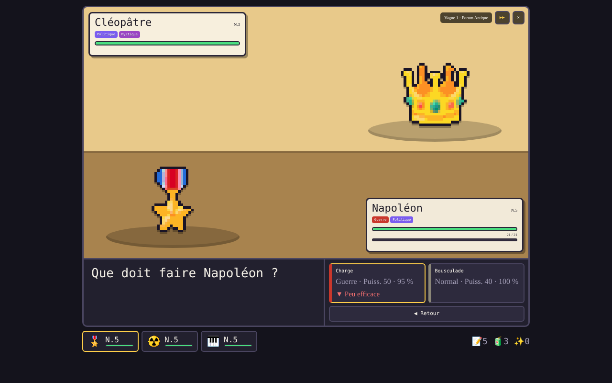
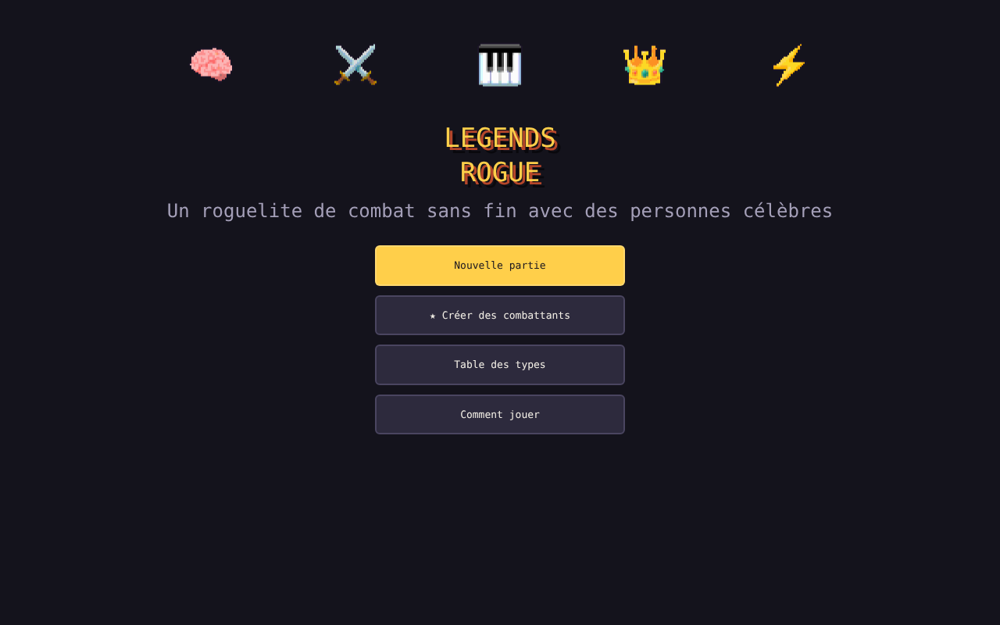
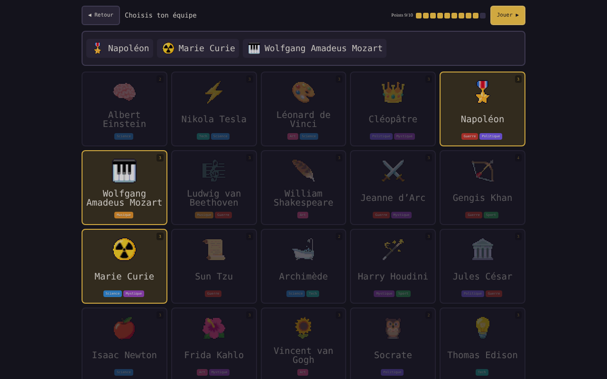
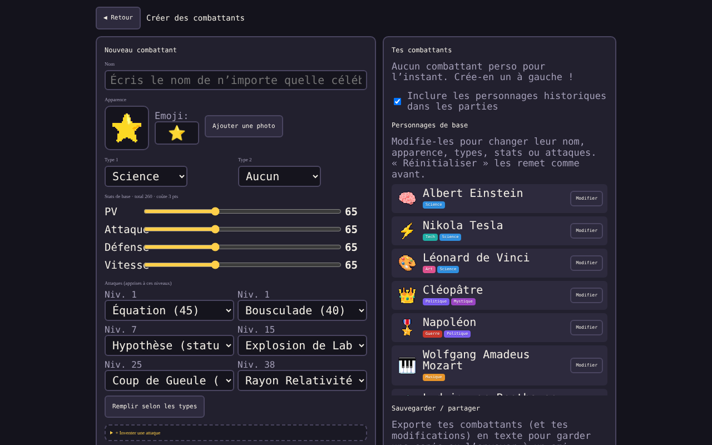

# 👑 Legends Rogue

Un roguelite de combat sans fin en pixel art, avec des personnes célèbres. Choisis ton équipe, enchaîne les vagues, recrute des combattants avec des Contrats, bats un boss toutes les 10 vagues… jusqu'où iras-tu ?

## ▶ Jouer

**[Jouer dans le navigateur](https://jjlb18.github.io/legends-rogue/)** (Edge, Chrome, Firefox et Safari, sur ordinateur et mobile)

## Fonctionnalités

- 30 personnages historiques et 8 types : Science, Art, Guerre, Politique, Musique, Sport, Mystique et Tech
- Forces et faiblesses des types, niveaux, nouvelles attaques, boosts de stats et boss
- **★ Créer des combattants** : ajoute qui tu veux avec un emoji ou ta propre photo, et choisis ses types, stats et attaques
- Modifie ou réinitialise n'importe quel personnage de base
- Exporte et importe tes combattants pour les partager avec tes amis
- Ta partie est sauvegardée automatiquement dans ton navigateur

## Extension Edge

`legends-rogue-edge.zip` (ou le dossier `extension/`) est une version extension pour Microsoft Edge / Chrome. Clique sur son icône pour ouvrir le jeu dans un nouvel onglet.

Pour l'essayer : va sur `edge://extensions`, active le **Mode développeur**, clique sur **Charger l'extension décompressée** et choisis le dossier `extension`.

## Captures d'écran

| Menu | Choix de l'équipe | Créer des combattants |
|---|---|---|
|  |  |  |
